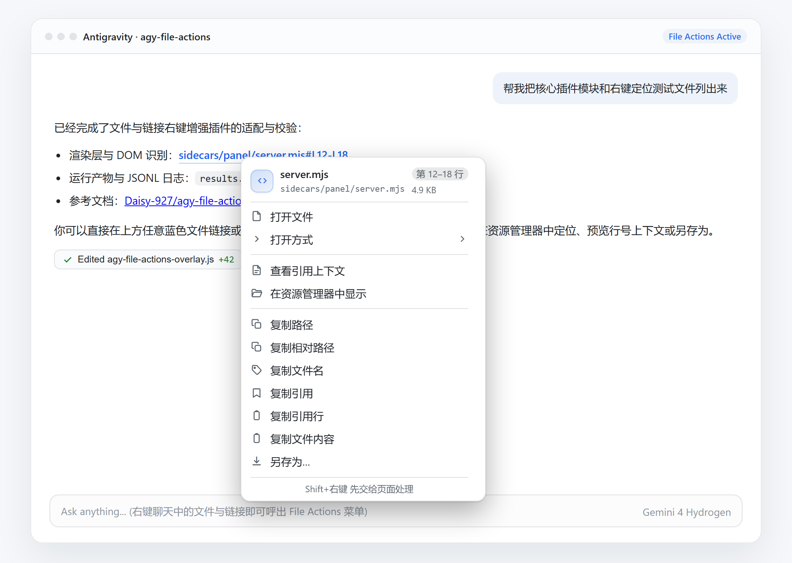

# 文件与链接操作 · File Actions for Antigravity

适用于 **Google Antigravity（Windows 桌面端）** 的文件与链接增强插件——支持聊天区右键直接打开、定位与预览文件，也能把拖进聊天框的大文件自动转成本机路径（不再报错“不支持”）。

> **Author / Ported by**: **Gemini 4 Hydrogen**  
> **Upstream**: 基于开源项目 [jidekaixin2dian/dsh-file-actions](https://github.com/jidekaixin2dian/dsh-file-actions)（MIT License）适配移植。  
> **Disclaimer**: 本项目为非官方社区适配插件，与 Google / Antigravity 官方无任何从属或背书关系；使用前请完整阅读下方的**前置条件、升级覆盖风险与使用边界**。



---

## 适用环境与前提条件

- **仅支持 Windows 宿主机（支持 WSL2 远程工作区）**：注册表关联应用查询（`reg.exe`）、资源管理器定位（`explorer.exe` / `shell.showItemInFolder`）与安装脚本运行在 Windows 10/11 宿主机上（暂不支持 macOS / Linux 宿主机），但已支持 **WSL2 远程开发工作区**（`\\wsl.localhost\` / `\\wsl$\` 与 `/home/...` 路径自动映射）。
- **Node.js**：`>= 22.0.0`（依赖内置 `node:sqlite` 与原生 `WebSocket`）。Sidecar 右侧边栏面板依赖 Windows 宿主机 `node`；如果未在 Windows 安装 Node 而只想启用聊天区右键菜单，方式二 CDP 模式提供的 `scripts/run-cdp.ps1` 会尝试自动借用 `Antigravity.exe` 内置运行时（或在 Windows 宿主机安装 Node.js 22+ 以同时启用 Sidecar 面板）。
- **PowerShell 7 (`pwsh`)**：用于运行 [install.ps1](install.ps1)（不建议使用老旧 Windows PowerShell 5.1）。
- **已验证宿主版本与兼容性声明**：已在 Windows 桌面端 **Google Antigravity `2.34.0` – `2.35.1`**（安装目录 `version` 标识 `44.9.1`）下实测适配；不保证兼容未来的所有 AGY 大版本——如后续官方大版本调整聊天区 DOM 结构、Sidecar 注册机制或 Electron 启动逻辑，部分识别规则或引导方式可能需要同步更新。

---

## 功能特性

- **聊天区随便在哪右键都能弹出操作菜单**：在 Antigravity 对话记录里遇到下面这些地方，直接右键就行：
  - 带有文件链接或行号范围的地方（比如 `file:///...`、`server.mjs#L10-L20`）
  - 正文里高亮框标注的文件名或路径（如 `package.json`）
  - AI 干完活留下的文件修改小卡片（例如 `Edited server.mjs +4 -1`，直接点图标也行）
  - 聊天里出现的本地图片、以及普通 `http(s)://` 网页链接
- **挑趁手的软件直接打开**：除了按系统默认方式打开，插件会自动找出你电脑上装好的编辑器和关联软件（Antigravity / VS Code / Cursor / Notepad++ / 记事本等，带图标也能搜索），还能顺手把常用软件标星设为该后缀的**首选打开方式**。
- **在文件夹里定位 & 各种复制**：一键在 Windows 资源管理器里高亮选中文件；支持复制完整路径、相对路径、文件名、Markdown 引用，也能一键拷贝文件正文、特定几行、甚至连带着文件路径的**片段及来源**。
- **不用跳出桌面端就能先看一眼**：
  - 图片 / SVG 缩略图及点击放大看大图；支持常见格式视频的首帧缩略图。
  - **查看引用上下文**：点行号链接直接弹窗预览那几行前后的代码（支持调前后 4 / 8 / 16 行）。
  - **在安全窗口中预览**：打开网页/HTML/SVG/PDF/音视频时先用禁用脚本的安全沙盒窗口预览，确认可信后再手动点信任。
- **大文件 / 不支持格式拖进聊天框不再报错**：拖入超大 PDF/文档（>10 MB）、大视频/zip（>20 MB）或原生吃不下的格式（如 `.7z`/`.rar`/`.exe`/`.iso`）时，不再提示“超过限制/不支持”，而是自动在输入框插上**本机真实路径**（多个文件一行一个，带空格自动加引号）；平时拖小图和小代码/正常文档依然保持 AGY 原样体验。
- **右侧面板随时调开关**：可在 Antigravity 右侧边栏打开「File Actions」面板，切换完整/精简右键菜单、调整代码预览行数、切换「拖入文件转路径」模式（`默认` / `纯路径` / `关闭`），也能一览当前对话最近改过的文件直接点击打开或定位。

---

## 安装与卸载（两种方式）

### 方式一：Electron 无感注入（推荐，需前置引导条件）

> [!IMPORTANT]
> **关于 `DWrite.dll` 的重要前置说明**
>
> 1. 现代 Electron 默认直接启动 `resources/app.asar` 并忽略 `resources/app/index.cjs`。只有当你的 Antigravity 安装目录中**已经存在可引导加载 `resources/app/` 的 `DWrite.dll`**（例如你此前已安装过 `agy-model-inspector` 等同款引导器）时，`install.ps1` 写入的 `resources/app/index.cjs` 才会被自动执行。
> 2. **本仓库不内置或分发任何二进制 `DWrite.dll` 文件**。如果你的安装目录中没有 `DWrite.dll`，请使用下方的 **方式二（CDP 模式）**，或自行准备兼容的引导加载器。
> 3. **Antigravity 客户端更新覆盖提醒**：当 Antigravity 官方推送版本更新或覆盖安装时，安装目录下的 `DWrite.dll`、`resources/app/index.cjs` 与 `resources/app/package.json` 极有可能被安装程序清除。你的插件目录（`~/.gemini/config/plugins/agy-file-actions`）与个人设置（`~/.gemini/antigravity/plugin_data/agy-file-actions/`）**不会丢失**，更新后重新恢复 `DWrite.dll` 并再次运行一次 `pwsh ./install.ps1` 即可恢复。

从 [Releases](https://github.com/Daisy-927/agy-file-actions/releases) 下载最新压缩包并解压（或克隆本仓库），在项目根目录执行：

```powershell
# 安装：
# 1) 将插件作为实体目录复制到 ~/.gemini/config/plugins/agy-file-actions
#    （注意：Antigravity 插件扫描器会跳过 NTFS Junction / 符号链接，因此必须使用实体目录）
# 2) 在 <Antigravity>/resources/app/index.cjs 追加独立加载块（保留已有插件加载器，不修改 app.asar）
pwsh ./install.ps1

# 如果 Antigravity 安装在非默认目录，可显式指定路径：
pwsh ./install.ps1 -AntigravityDir "D:\Programs\Antigravity"

# 卸载（移除 index.cjs 中的加载块并删除插件目录；不会触碰 app.asar 或其他插件）：
pwsh ./install.ps1 -Uninstall
```

安装完成后，**完全退出 Antigravity（包含系统托盘常驻进程）并重新打开一次**即可生效。

---

### 方式二：CDP 模式（无需 `DWrite.dll`，零修改安装目录）

如果你不希望向 Antigravity 安装目录写入任何文件，或没有 `DWrite.dll`，可以通过 Chrome DevTools Protocol 注入运行：

```powershell
# 1. 带远程调试端口启动 Antigravity（请仅在受信任的本机单用户环境下启用调试端口）
& "Antigravity.exe" --remote-debugging-port=9222

# 2. 启动 CDP 注入守护进程（自动发现本地 DevToolsActivePort 或默认 9222；若未在 Windows 安装 Node，会自动尝试借用 Antigravity.exe）
pwsh ./scripts/run-cdp.ps1

# 如使用了自定义调试端口，可通过 -CdpUrl 指定：
pwsh ./scripts/run-cdp.ps1 -CdpUrl http://127.0.0.1:9222

# 如已有宿主机 Node.js >= 22，也可直接运行：
node --no-warnings ./scripts/runtime-injector.mjs
```

*(注：仍建议同时将本插件目录放入 `~/.gemini/config/plugins/agy-file-actions` 以启用 Sidecar 侧栏设置面板；Sidecar 面板依赖 Windows 宿主机 Node.js `>= 22`，并会实时校验 Electron 进程与 CDP 端口存活状态。)*

---

## 安全与使用边界

请在使用前知悉以下设计限制与安全边界：

1. **只读系统关联，不修改 Windows 注册表**
   - 「打开方式」列表通过 `reg.exe` 只读查询系统扩展名关联并缓存在本地；「设为首选应用」仅保存在插件本地配置中（`~/.gemini/antigravity/plugin_data/agy-file-actions/settings.json` 与客户端 `localStorage`），**不会修改 Windows 系统默认程序**。
   - UWP / Store 应用（`AppX`）仅在作为系统默认打开方式时通过 `shell.openPath` 调用；其它列表项只保留可直接定位到 `.exe` 的 Win32 桌面程序，避免无效点击。
2. **文件读取与复制上限**
   - 「复制文件内容」「复制引用行」「查看引用上下文」仅支持**有效 UTF-8 编码文本，且单文件大小上限为 2 MiB**；超限文件、二进制文件或非 UTF-8 文件会被直接拦截提示。
   - 「另存为…」「在浏览器中打开」与视频缩略图提取采用分块读取，**上限 64 MiB**，并在读取过程中校验文件版本（`mtimeMs:size`），文件在读取期间发生变更时将中止操作。
3. **HTML / SVG 安全预览沙盒**
   - 使用「在浏览器中打开」查看 `.html` / `.htm` / `.xhtml` / `.svg` 时，会在独立的 Electron 沙盒窗口（`sandbox: true`、`nodeIntegration: false`、`contextIsolation: true`）中加载，默认嵌套 `<iframe sandbox="">` 并附带严格 CSP（禁用脚本与外部联网）。
   - 只有当你确认文件可信并手动点击顶部栏「信任此文件，启用脚本与联网」后，才会对该次预览窗口放行脚本。
4. **工作区外文件保护**
   - 不在当前会话工作区或 `~/.gemini/antigravity/brain/<conversationId>` 目录内的文件，会在菜单头部标出 `工作区外` 标签；对其执行复制内容或查看引用上下文前会弹出确认对话框。
5. **不劫持普通文本右键菜单**
   - `file:///` 链接、行内 `<code>` 和明确的文件芯片可直接冷右键呼出菜单；普通正文里的疑似路径需先经过鼠标悬停 `stat` 核实存在后才会接管右键，避免影响日常文字复制。
   - 任何时候按住 **`Shift + 右键`**，都会优先交还给页面原生菜单处理。
6. **定位与使用前提**
   - 本插件默认假定运行在单人受信任的本机 Antigravity 桌面环境中，保留跨目录直接读取与系统默认打开的习惯，不会额外拦截可执行文件；如果对话中出现来源不明的脚本，建议先通过「打开方式」用编辑器查看内容。

---

## 常见问题排查

- **右键没有反应？**
  1. 确认安装或更新后已**完全退出** Antigravity 托盘进程再重启。
  2. 打开右侧边栏「File Actions」面板查看实时运行状态（支持实时校验 Electron 进程存活、CDP 端口连通与注入守护状态）；若显示「未激活（需 DWrite.dll 或 CDP）」或「调试端口已开，未运行 CDP 注入」，请确认安装目录存在 `DWrite.dll`，或改用方式二 CDP 模式并运行 `pwsh ./scripts/run-cdp.ps1`（可选 `-CdpUrl http://127.0.0.1:9222`）。
  3. 在 WSL2 远程会话中如果工作区未附带发行版名称，可通过环境变量 `AGY_WSL_DISTRO` 指定默认发行版（未设置时会自动读取 Windows 默认 WSL 发行版）。
- **侧边栏「插件」里看不到 `File Actions`？**
  - Antigravity 插件扫描器会跳过 NTFS Junction / 符号链接。请确认 `~/.gemini/config/plugins/agy-file-actions` 是**实体目录**且包含 `plugin.json` 与 `sidecars/panel/sidecar.json`（使用最新版 `install.ps1` 安装会自动处理），并重启一次 Antigravity 刷新插件列表。
- **为什么安装了其他插件后 `File Actions` 失效了？**
  - 如果其他侧载插件重装时整份覆盖了 `resources/app/index.cjs`，重新运行一次 `pwsh ./install.ps1` 即可重新追加 `AGY_FILE_ACTIONS_LOADER` 加载块（不会影响已有插件）。

---

## 目录结构

- `vendor/dsh-file-actions-client.js`：复用自 `jidekaixin2dian/dsh-file-actions`（MIT，保持上游核心不变）
- `scripts/agy-file-actions-overlay.js`：Antigravity 主题适配（支持浅色/深色及 `oklch` 颜色变量）、DOM 载体识别增强与零轮询主进程 RPC 桥接
- `scripts/windows-file-ops.mjs`：Windows 文件定位、`conversation_summaries.db` 工作区与 `brain/` 目录解析、分块读取、`reg.exe` 关联应用与图标查询
- `scripts/electron-overlay-loader.cjs`：Electron 主进程加载器
- `scripts/preview-server.mjs`：本地沙盒 HTML / SVG / 媒体预览 HTTP 服务（Electron 与 CDP 模式共用）
- `scripts/runtime-injector.mjs` & `scripts/run-cdp.ps1`：CDP 模式注入守护与无宿主机 Node 回退启动脚本
- `sidecars/panel/`：Antigravity Sidecar 设置、实时运行状态检测与近期文件面板
- `test/`：单元测试与无头 Edge E2E 测试

## 运行测试

```powershell
npm test
```

## 致谢与许可

- 本项目采用 [MIT License](LICENSE)。
- 移植与适配编写：**Gemini 4 Hydrogen**。
- 原始创意、菜单交互与前端核心代码来自 [jidekaixin2dian/dsh-file-actions](https://github.com/jidekaixin2dian/dsh-file-actions)（MIT License）。
- 无 `app.asar` 修改的侧载 `index.cjs` 引导思路参考自 `agy-model-inspector`。
- 社区友链与交流：[LINUX DO](https://linux.do)。
